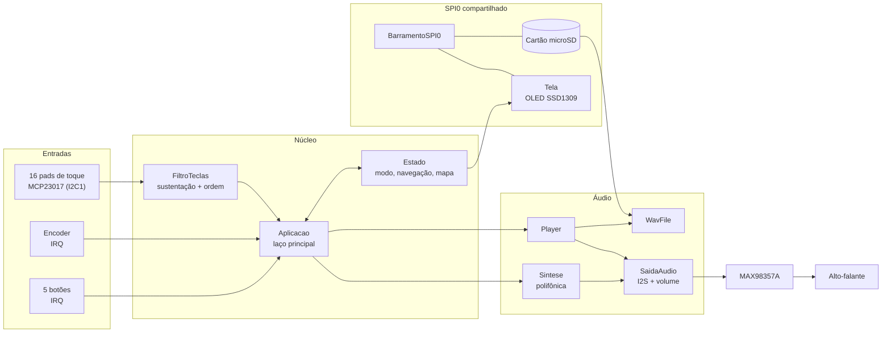
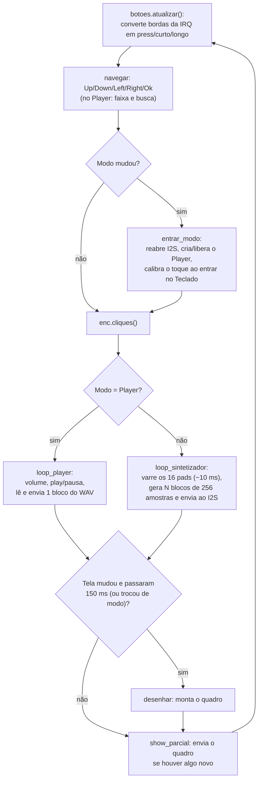
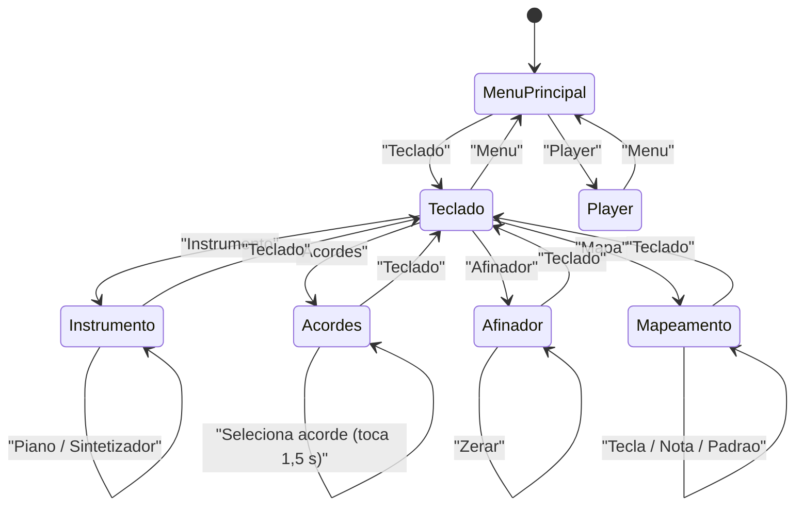

# 🎹 RaspHarmony

**Sistema embarcado sintetizador musical polifônico e reprodutor de arquivos WAV**, em MicroPython, para Raspberry Pi Pico.
Projeto da disciplina **EA801 — FEEC / Unicamp**.

> A versão atual do projeto é a **versão PCB** (`pcb_version/`): placa principal própria + teclado de toque capacitivo de 16 pads.
> A versão protoboard (`protoboard_version/`) foi a primeira etapa e continua disponível como referência.


Imagens Versão PCB


Link do Vídeo Demonstrativo <https://youtu.be/pUogGHoXqIc?si=QHfIiYL4WNYgmJ7h>


Design placa principal e keyboard touch

180mm x 112mm


195mm x 142mm

---

## Sumário

1. [Visão geral](#1-visão-geral)
2. [Equipe](#2-equipe)
3. [Estrutura do repositório](#3-estrutura-do-repositório)
4. [Versões do projeto](#4-versões-do-projeto)
5. [Hardware (versão PCB)](#5-hardware-versão-pcb)
6. [Arquitetura de software (versão PCB)](#6-arquitetura-de-software-versão-pcb)
7. [Subsistemas em detalhe](#7-subsistemas-em-detalhe)
8. [Interface e menus](#8-interface-e-menus)
9. [Desempenho, memória e tempo real](#9-desempenho-memória-e-tempo-real)
10. [Instalação e execução](#10-instalação-e-execução)
11. [Guia de uso](#11-guia-de-uso)
12. [Configuração](#12-configuração)
13. [Preparação das músicas](#13-preparação-das-músicas)
14. [Testes e validação](#14-testes-e-validação)
15. [Solução de problemas](#15-solução-de-problemas)
16. [Versão protoboard (legado)](#16-versão-protoboard-legado)
17. [Limitações conhecidas e próximos passos](#17-limitações-conhecidas-e-próximos-passos)
18. [Referências e links](#18-referências-e-links)
19. [Licença e créditos](#19-licença-e-créditos)

---

## 1. Visão geral

O RaspHarmony tem dois modos principais, escolhidos no menu do display OLED, e o modo Teclado tem quatro submodos:

| Modo | O que faz |
|---|---|
| **Teclado** | Sintetizador polifônico (até 4 vozes) tocado pelo **teclado de toque capacitivo de 16 pads**. O teclado soa em todos os submodos abaixo. |
| ↳ **Instrumento** | Escolhe **Piano** (duas cordas, decaimento em duas fases e "martelada") ou **Sintetizador** (onda "serra" suave). Left/Right troca a **oitava (3 a 5)**. Mostra a atividade das 16 teclas em tempo real. |
| ↳ **Acordes** | 48 acordes (12 raízes × 4 tipos: maior, menor, diminuto, aumentado), tocados por 1,5 s ao selecionar. |
| ↳ **Afinador** | Ajuste fino de cada nota em **±50 cents**, com tom de referência (senoide pura) e medidor visual. Vale para todas as oitavas e instrumentos. |
| ↳ **Mapeamento** | Define qual nota cada um dos 16 pads toca. Dois padrões prontos (cromático e Dó maior em duas oitavas) ou mapeamento personalizado, com prévia sonora. |
| **Player** | Reprodutor de arquivos **WAV** (PCM 16 bits, mono ou estéreo) do cartão microSD, com volume, play/pausa, faixa anterior/próxima e avanço/retrocesso de 5 s. |
Imagens da interface no Display:


**Principais características técnicas (versão PCB)**

- Áudio digital por **I2S** a **44,1 kHz / 16 bits** direto para o amplificador **MAX98357A** (sem DAC analógico, sem PWM). O I2S se reconfigura sozinho na taxa/canais de cada WAV.
- Motor de síntese por **tabela de onda** com acumulador de fase de 24 bits, interpolação linear e envelopes, com os laços críticos em **`@micropython.viper`**.
- **Teclado capacitivo DIY**: 16 pads com resistor de 1 MΩ, lidos por um expansor **MCP23017** medindo o **tempo de descarga** de cada pad, com resolução de ~1 µs usando o pino **INT** do expansor como cronômetro.
- **Um único SPI0 de hardware compartilhado** entre o cartão SD e o display OLED **SSD1309**, em pinos diferentes, por meio de um seletor de barramento (`spibus.py`).
- **Botões de navegação por interrupção** (clique curto, longo e repetição), sem `sleep` bloqueante no laço principal.
- **Tolerante a falhas**: funciona sem cartão SD (o Player avisa) e sem o MCP23017 (a tela avisa "Sem MCP23017!"); erros fatais são gravados em `/erro.txt` e a placa reinicia sozinha.

---

## 2. Equipe

| Nome | RA |
|---|---|
| Paulo Sergio Gonçalves Júnior | 218474 |
| Vinicius Pedrillo de Souza | 258667 |

Disciplina **EA801** — Faculdade de Engenharia Elétrica e de Computação (FEEC), Unicamp.
Docente responsável: Fabiano Fruett

---

## 3. Estrutura do repositório

```text
RaspHarmony/
├── README.md                        ← este documento
├── MicroPy_PICO-v1.29.0.uf2         ← firmware MicroPython (build para RP2040 / Pico)
├── musicas/
│   ├── Playlist.md                  ← lista de músicas e comando de conversão
│   └── MP3/                         ← músicas de origem (convertê-las para WAV)
├── pcb_version/                     ← ★ versão atual
│   ├── hardware/
│   │   ├── Design_RaspHarmony.epro2 ← projeto EasyEDA Pro (esquemático + layout)
│   │   ├── main_pcb/                ← Gerber da placa principal
│   │   └── keytouch_pcb/            ← Gerber do teclado de toque
│   └── software/
│       ├── main/main.py             ← ponto de entrada (copiar como /main.py)
│       └── lib/                     ← módulos (copiar para /lib no Pico)
└── protoboard_version/              ← versão anterior (legado)
    ├── protoboard.md
    ├── modular/                     ← main/main.py + lib/
    └── monolitico/RaspHarmony_All.py
```

---

## 4. Versões do projeto

O projeto foi feito em duas etapas, ambas em **MicroPython**:

| | **Protoboard** | **PCB** |
|---|---|---|
| Placa | Raspberry Pi **Pico 2** (RP2350) | Raspberry Pi **Pico** (RP2040) |
| Estado | Concluída (legado) | **Concluída / em desenvolvimento ativo** |
| Pasta | `protoboard_version/` | `pcb_version/` |
| Ligações | Esquema do [Wokwi](https://wokwi.com/projects/475915740521352193) | `pcb_version/hardware` |
| Display | OLED SH1106 I2C | OLED **SSD1309 2,42" SPI** |
| Teclado | Matriz 4×4 (12 notas + 4 controles) | **16 pads capacitivos** via MCP23017 |
| Navegação | Joystick analógico + botão | **5 botões** (Up, Down, Left, Right, Ok) |
| Encoder | Volume / oitava / afinação + botão | Volume / afinação (botão não usado) |
| Mapeamento de teclas | Fixo | **Configurável** (2 padrões + personalizado) |

### Principais mudanças no software da PCB

| Protoboard | PCB |
|---|---|
| `joystick.py`, `botao.py` | `botoes.py`: 5 botões por IRQ, com eventos `press` / `curto` / `longo` (repetição) |
| `teclado.py` (varredura de matriz) | `toque.py` (medição capacitiva) + `teclas.py` (filtro de sustentação) + `mcp23017.py` |
| `sh1106.py` (I2C) | `ssd1309.py` + `spibus.py` (SPI0 compartilhado com o SD) |
| — | Novo modo **Mapeamento** e novo layout de UI com ícones, abas e rodapé |
| — | `main.py` com espera de 500 ms na partida, log em `/erro.txt` e reinício automático |

---

## 5. Hardware (versão PCB)

### 5.1 Lista de materiais

| Item | Descrição | Qtd. |
|---|---|---|
| Microcontrolador | Raspberry Pi Pico (RP2040) | 1 |
| Encoder | Encoder rotativo (tipo KY-040) | 1 |
| Amplificador de áudio | Módulo DAC + amplificador I2S **MAX98357A** | 1 |
| Alto-falante | 4 Ω / 3 W | 1 |
| Armazenamento | Módulo leitor microSD (SPI) + cartão microSD 2 GB | 1 |
| Display | OLED 128×64 SPI 2,42" com controlador **SSD1309** | 1 |
| Botões direcionais | Botões de navegação 12 mm × 12 mm | 5 |
| Expansor 16 GPIO I2C | CI **MCP23017** | 1 |
| Teclado de toque | PCB keytouch com 16 pads + resistores de 1 MΩ para GND | 1 |
| Conector 6 vias | Kzinho macho 6 vias 90° | 2 |
| Cabo flat 6 vias | Com 2 Kzinho fêmea | 1 |
| Fonte de alimentação | Fonte 5 V 2 A, conector P4 | 1 |
| Conector de alimentação | Jack DC P4 fêmea para PCB | 1 |
| Capacitor de alimentação | Capacitor eletrolítico de 100 µF | 1 |
| Parafusos | Parafusos de fixação M1.5 | 4 |

### 5.2 Diagrama de ligações

**PCB principal**


**PCB teclado**


Os arquivos de fabricação (Gerber) estão em `pcb_version/hardware/main_pcb/` e `pcb_version/hardware/keytouch_pcb/`, e o projeto editável em `Design_RaspHarmony.epro2` (EasyEDA Pro).

### 5.3 Pinagem

Fonte: `pcb_version/software/lib/config.py`.

| Função | Sinal | GPIO | Periférico | Observação |
|---|---|---|---|---|
| **Display OLED (SSD1309)** | SCK | GP18 | **SPI0** | 8 MHz; SPI0 compartilhado com o SD |
| | MOSI | GP19 | **SPI0** | |
| | CS | GP22 | Digital | |
| | RES | GP20 | Digital | |
| | DC | GP21 | Digital | |
| **Cartão SD** | SCK | GP2 | **SPI0** | 12 MHz após a inicialização |
| | MOSI | GP3 | **SPI0** | |
| | MISO | GP0 | **SPI0** | Fica sempre ligado ao SPI0 |
| | CS | GP4 | Digital | |
| **Botões de navegação** | Up | GP12 | Digital + IRQ | Pull-up interno, ativo em nível baixo |
| | Right | GP1 | Digital + IRQ | |
| | Left | GP13 | Digital + IRQ | |
| | Down | GP15 | Digital + IRQ | |
| | Ok | GP14 | Digital + IRQ | |
| **Encoder** | A (CLK) | GP26 | Digital + IRQ | Pull-up interno |
| | B (DT) | GP27 | Digital + IRQ | Pull-up interno |
| **Áudio I2S** | BCLK (SCK) | GP6 | I2S0 | |
| | LRC (WS) | GP7 | I2S0 | Deve ser sempre o GPIO seguinte ao BCLK |
| | DIN (SD) | GP5 | I2S0 | |
| **Expansor MCP23017** | SDA | GP10 | I2C1 | 400 kHz, endereço `0x20` |
| | SCL | GP11 | I2C1 | |
| | RST | GP9 | Digital | Reset ativo em nível baixo |
| | INT | GP8 | Digital | Cronômetro da descarga dos pads (modo INT) |

> GP18/GP19 (OLED) e GP0/GP2/GP3 (SD) são pinos do **mesmo** periférico SPI0. Ver [7.3](#73-spi0-compartilhado-spibuspy).

### 5.4 Teclado de toque


Cada pad está ligado a um GPIO do MCP23017 (GPA0–GPB7) e tem um resistor de **1 MΩ para GND**. O pad *n* corresponde ao índice *n − 1* no software. Os mapeamentos padrão (lidos na ordem física, do pad 16 ao pad 1) são:

| Pad | 16 | 15 | 14 | 13 | 12 | 11 | 10 | 9 | 8 | 7 | 6 | 5 | 4 | 3 | 2 | 1 |
|---|---|---|---|---|---|---|---|---|---|---|---|---|---|---|---|---|
| **Padrão 1** (cromático) | F | G | A | B | C | C# | D | D# | E | F | F# | G | G# | A | A# | B |
| **Padrão 2** (Dó maior, 2 oitavas) | C | D | E | F | G | A | B | C | D | C' | D' | E' | F' | G' | A' | B' |

> As notas são relativas à oitava atual (Left/Right no modo Instrumento); `'` = oitava seguinte. No Padrão 2, os pads 16 a 8 ficam na oitava atual e os pads 7 a 1 na seguinte. Qualquer pad pode ser remapeado no modo **Mapeamento** (até 35 semitons acima do Dó da oitava atual).

### 5.5 Alimentação

| Item | Valor |
|---|---|
| Fonte | Externa **5 V / 2 A** pelo jack P4 (VSYS), com capacitor de 100 µF |
| Lógica | 3,3 V (regulador do Pico) |
| Alimentação do MAX98357A | 5 V |
| Partida | `main.py` aguarda **500 ms** para a tensão estabilizar antes de inicializar SD, OLED e MCP23017 |

---

## 6. Arquitetura de software (versão PCB)

### 6.1 Diagrama de blocos



### 6.2 Módulos

| Módulo | Responsabilidade |
|---|---|
| `main/main.py` | Ponto de entrada: espera a alimentação estabilizar, executa a `Aplicacao`, grava erros em `/erro.txt` e reinicia a placa |
| `config.py` | Pinos, constantes, tabelas de menu, mapeamentos padrão e parâmetros de ajuste |
| `app.py` | `Aplicacao`: monta o hardware e executa o laço principal |
| `estado.py` | `Estado`: estado global, navegação dos menus e mapeamento das teclas |
| `ui.py` | `Tela`: desenho de todas as telas no OLED |
| `botoes.py` | `Botoes` / `BotaoNav`: 5 botões por IRQ com debounce, clique curto, longo e repetição |
| `encoder.py` | `Encoder`: decodificação em quadratura por IRQ |
| `toque.py` | `TecladoToque`: medição capacitiva dos 16 pads (modo INT ou modo I2C), calibração e detecção |
| `teclas.py` | `FiltroTeclas`: sustentação mínima das teclas e ordem de pressionamento |
| `spibus.py` | `BarramentoSPI0`, `SPIVirtual`, `SSD1309_SPI0`: compartilhamento do SPI0 entre SD e OLED |
| `armazenamento.py` | Montagem do SD e lista de `.wav` |
| `wavfile.py` | `WavFile`: leitura de cabeçalho, dados e busca em WAV PCM |
| `audio.py` | `SaidaAudio`: I2S, volume por software e reconfiguração automática |
| `midi.py` | `MIDI`: notas, frequências, acordes, escalas e afinação |
| `sintese.py` | `Sintese`: motor polifônico (tabela de onda + envelopes) |
| `player.py` | `Player`: lista de faixas, play/pausa, busca, repetição |
| `ssd1309.py` | Driver do OLED SSD1309 (SPI) |
| `mcp23017.py` | Driver do MCP23017 (de terceiros, Mike Causer — usado só na inicialização) |
| `sdcard.py` | Driver do cartão SD (de terceiros, micropython-lib) |

### 6.3 Laço principal

O sistema é **single-thread e cooperativo**. As IRQs (botões e encoder) só guardam carimbos de tempo e passos; nada de SD, I2S, I2C ou OLED roda dentro delas. A escrita de áudio no I2S é **bloqueante** quando o buffer está cheio, e é isso que dá o ritmo ao laço.



---

## 7. Subsistemas em detalhe

### 7.1 Teclado de toque capacitivo (`toque.py`, `teclas.py`)

**Princípio (tempo de descarga)**

1. Os GPIOs do MCP23017 viram **saída em nível alto** por `TOQUE_CARGA_US` (20 µs): os pads carregam até 3,3 V.
2. Os GPIOs viram **entrada** (sem pull-up): cada pad descarrega pelo resistor de 1 MΩ com constante de tempo R·C.
3. O dedo soma capacitância → descarga mais lenta → o pad fica em nível alto por mais tempo.

**Dois métodos de medição** (`TOQUE_USAR_INT` em `config.py`):

| | **Modo INT** (padrão) | **Modo I2C** (antigo) |
|---|---|---|
| Como mede | Habilita a interrupção de **um pad por vez** no MCP23017 (`INTCON`/`DEFVAL` = 1, `IOCON.MIRROR` = 1) e mede, com o timer de 1 µs do RP2040 (viper, acesso direto ao `TIMERAWL` e `SIO GPIO_IN`), o tempo até o pino INT cair | Amostragem em **tempo equivalente**: vários ciclos de carga/descarga, cada um com UMA leitura I2C num atraso crescente (`TOQUE_PASSO_US`) |
| Resolução | ~1 µs | ~8 µs |
| Limiar típico | `TOQUE_LIMIAR_US = 3` | `TOQUE_LIMIAR_US = 24` |

Durante o trecho crítico (soltar o pad → ler), as **IRQs ficam desligadas** (`TOQUE_SEM_IRQ`) para o atraso ser exato.

**Calibração** — feita ao entrar no modo Teclado, vinda do menu ou do Player (**não encoste nos pads nesse momento**):
- mede `TOQUE_CICLOS_CAL` vezes cada pad livre e guarda a **linha de base** (ponto fixo ×16) e o **ruído** (máx − mín);
- limiar por pad = `max(TOQUE_LIMIAR_US, TOQUE_K_RUIDO × ruído)`;
- pads que não descarregam até o timeout são marcados como **defeito** e ignorados.

**Detecção** (a cada varredura, ~10 ms):
- **histerese**: tocado acima do limiar, solto abaixo de 60 % dele (`TOQUE_SOLTAR_PCT`);
- **debounce** de 2 varreduras;
- a linha de base **acompanha a deriva** lentamente enquanto o pad está livre;
- pad "preso" por mais de 30 s (`TOQUE_PRESO_MS`) é recalibrado.

**Recuperação do I2C**: ruído do dedo pode travar o MCP23017 no meio de um byte. Em caso de `OSError`, o driver gera 9 clocks + STOP para soltar o SDA, dá **reset de hardware** no MCP23017 (GP9), recria o I2C e reescreve os registradores, mantendo a calibração.

**Filtro de sustentação** (`teclas.py`): uma tecla detectada continua valendo por `TECLA_SEGURA_MS` (100 ms) depois da última detecção. Isso garante duração mínima à nota e evita "picote" (redisparo do ataque e da martelada) quando uma varredura falha. O filtro também guarda a **ordem** de pressionamento: com mais teclas que vozes, as notas mais antigas são mantidas.

### 7.2 Botões e encoder (`botoes.py`, `encoder.py`)

**Botões de navegação**
- Cada botão tem IRQ nas duas bordas (`hard=True`), que só registra carimbos de tempo, com debounce de 30 ms. Um aperto curto **não se perde** mesmo quando o laço demora (ex.: leitura de um bloco do SD).
- `atualizar()`, chamado uma vez por volta do laço, gera os eventos:

| Evento | Significado |
|---|---|
| `press` | Botão apertado (dispara na hora) |
| `curto` | Apertado e solto em menos de 500 ms (`NAV_LONGO_MS`) |
| `longo` | Segurado além de 500 ms; repete a cada 300 ms (`NAV_REPETE_MS`) |
| `seg` | Estado atual (apertado ou não) |

**Encoder rotativo**
- A interrupção soma passos usando uma tabela de decodificação em quadratura (16 entradas). `cliques()` lê e zera o contador com as IRQs desligadas, guardando o resto de um clique incompleto.
- Passos por clique (detent) = 2 por padrão; use 4 em encoders que geram 4 passos por clique.
- Na PCB o encoder serve só para **volume** (e afinação no Afinador). O botão do encoder não é usado.

### 7.3 SPI0 compartilhado (`spibus.py`)

O SD (GP2/GP3/GP0) e o OLED (GP18/GP19) usam o **mesmo periférico SPI0**, em pinos diferentes. Dois objetos `SPI(0, ...)` não podem coexistir: cada um reconfigura o periférico, e os pinos do dispositivo fora de uso continuariam com clock (causando "picote").

Solução: um único `SPI(0)` e um **seletor**:

1. Antes de falar com um dispositivo, o seletor devolve SCK/MOSI do anterior para GPIO (SCK = 0, MOSI no nível ocioso).
2. Reconfigura o SPI0 com os pinos e a velocidade do novo dispositivo (OLED a 8 MHz, SD a 12 MHz).
3. O **SD é o estado de repouso**: o OLED só ocupa o barramento durante o envio do quadro e devolve o SPI0 ao SD logo em seguida.

O MISO (GP0) fica sempre ligado ao SPI0 e é passado em toda reconfiguração, para o SPI nunca cair no MISO padrão (GP4, que é o CS do SD). Como nenhuma IRQ usa o SPI e o laço tem uma thread só, não há acesso concorrente.

### 7.4 Display e interface (`ui.py`, `ssd1309.py`)

- OLED **128×64 SSD1309**, fonte 8×8 do `framebuf` → **16 colunas × 8 linhas**. A fonte é só ASCII: `ascii_()` troca letras acentuadas (nomes de faixas).
- Layout comum: barra de título invertida (título | extra | ícone de alto-falante + volume) em y = 0..10, conteúdo em y = 13..53, rodapé com dicas ou abas em y = 55..63.
- **Redesenho condicionado**: `chave_visual()` resume o que está na tela; o quadro só é remontado quando ela muda **e** já passaram 150 ms (`UI_MIN_MS`) — ou imediatamente ao trocar de modo.
- `show_parcial()` envia o quadro inteiro só se houver algo novo (o SPI a 8 MHz é rápido o bastante, ao contrário do I2C da versão protoboard).
- Elementos visuais: miniatura de teclado, indicador das 16 teclas ativas, medidor de afinação, disco girando e barra de progresso no Player, letreiro rolante para nomes longos.

<!-- 📷 IMAGENS: adicionar uma captura de cada tela do OLED (Menu, Teclado, Instrumento, Acordes, Afinador, Mapeamento, Player) -->

### 7.5 Áudio (`audio.py`)

- **I2S0 TX**, 16 bits, 44,1 kHz, mono no sintetizador. No Player, se o WAV tiver outra taxa ou for estéreo, `saida_wav` **reabre o I2S** na configuração do arquivo.
- O I2S só é recriado quando taxa, canais ou buffer mudam. Antes de alocar, o I2S antigo é liberado e o heap compactado (`gc.collect()`); se ainda faltar memória contígua, tenta com **buffers menores** (até 4 KB) em vez de derrubar o programa.
- O MAX98357A **não tem controle de volume por I2S**, então o volume é **por software**, com **curva quadrática** (`ganho = vol² · 4096 / 10000`):
  - no Player, `aplicar_volume` (viper) multiplica o bloco PCM em memória;
  - no sintetizador, o ganho entra na etapa final (`finalizar`).
- Passo de volume: **2 %** por clique; volume inicial: **16 %**.
- Com o Player pausado, são enviados **blocos de silêncio** para manter o I2S alimentado.

### 7.6 Síntese (`midi.py`, `sintese.py`)

**Notas e afinação**
- MIDI → frequência: `f = 440 · 2^((n − 69)/12 + cents/1200)`, com **−50 a +50 cents** por nota (uma das 12), válido para todas as oitavas.
- Nota de um pad: `MIDI = 12 · (oitava + 1) + mapa[pad]`.
- Acordes: tríades a partir de C4 (MIDI 60) com intervalos `[0,4,7]` maior, `[0,3,7]` menor, `[0,3,6]` diminuto e `[0,4,8]` aumentado.

**Motor de síntese**

| Parâmetro | Valor |
|---|---|
| Bloco de geração | 256 amostras (≈ 5,8 ms) |
| Tabelas de onda | 1024 amostras (int16) |
| Acumulador de fase | 24 bits (resolução ≈ 0,0026 Hz) |
| Leitura da tabela | Interpolação linear |
| Amplitude | Ponto fixo Q12 com **rampa linear** dentro do bloco |
| Polifonia máxima | **4 vozes** (`MAX_VOZES`) |
| Limitador | "Joelho suave" antes de saturar em 16 bits |

As rotinas pesadas (`mix_voz`, `mix_dupla`, `finalizar`, `aplicar_volume`) são compiladas com `@micropython.viper`.

**Alimentação do I2S durante a varredura do toque**: a varredura dos pads leva ~10 ms, mais que um bloco (5,8 ms). Por isso, depois de cada varredura, `escrever_sintese` gera blocos suficientes para cobrir o tempo em que o áudio ficou parado, mais `SINT_MARGEM_BLOCOS` (3) de folga, limitado a `SINT_BLOCOS_MAX` (12). O excesso não faz mal: `i2s.write()` bloqueia quando o buffer enche.

**Instrumentos**

| Instrumento | Característica |
|---|---|
| **Piano** | Tabela "rica" escolhida por registro (grave / médio / agudo) somada a uma tabela "escura"; decaimento em **duas fases** (rápida τ ≈ 0,22 s + lenta de 3,2 s no grave a 0,9 s no agudo); **brilho que decai**; **duas cordas** levemente desafinadas (~2,5 cents); **martelada** por ruído de ~17 ms. Tabelas normalizadas por **RMS**. |
| **Sintetizador** | Onda "serra" suave, ataque suave e sustentação plena. |
| **Afinador** | Senoide pura (tom de referência). |

> As constantes de envelope são definidas "por bloco de 256" e **escaladas** pelo tamanho real do bloco, então os tempos em segundos não mudam se o bloco for alterado.

### 7.7 Player e arquivos WAV (`player.py`, `wavfile.py`, `armazenamento.py`)

- O SD é montado em `/sd`. A lista de faixas contém os `.wav` da **raiz** do cartão, em **ordem alfabética**. Subpastas não são lidas.
- `WavFile` interpreta o cabeçalho RIFF, ignora chunks extras e aceita **somente PCM**. O Player recusa arquivos que não sejam **16 bits, mono ou estéreo**.
- Leitura em blocos de **4096 bytes** direto para um buffer pré-alocado (`readinto`), sem alocar memória a cada bloco.
- Ao entrar no Player, a **faixa 1 começa a tocar automaticamente**. Fim de faixa → próxima; a última volta para a primeira (`REPETIR_LISTA = True`).
- Left/Right **segurado** avança/retrocede **5 s** (`PULO_S`) a cada repetição (300 ms).
- Ao sair do Player, a reprodução para e o objeto `Player` é liberado (recupera a RAM do buffer).

---

## 8. Interface e menus



- A tela **Teclado** tem duas colunas: esquerda = Instrumento / Acordes / Afinador; direita = Mapa / Menu. Up/Down gira dentro da coluna; Left/Right troca de coluna.
- Ao voltar de um submodo, o cursor fica no item de onde se veio.
- Os pads de toque **soam em todos os submodos do Teclado**; o menu principal e o Player ficam em silêncio.

---

## 9. Desempenho, memória e tempo real

### 9.1 Latências e buffers

| Item | Valor | Cálculo |
|---|---|---|
| Buffer I2S (sintetizador) | 6144 bytes | 3072 amostras ÷ 44100 ≈ **70 ms** |
| Bloco de síntese | 256 amostras | ≈ **5,8 ms** |
| Varredura do teclado de toque | 16 pads | ≈ **10 ms** (modo INT) |
| Sustentação mínima da tecla | 100 ms | `TECLA_SEGURA_MS` |
| Buffer I2S (Player) | 16384 bytes | 8192 amostras ÷ 44100 ≈ **186 ms** (mono) |
| Bloco de leitura do SD | 4096 bytes | ≈ **46 ms** de áudio mono |
| Taxa de dados do WAV (mono, 16 bits, 44,1 kHz) | 88,2 kB/s | ≈ 5,3 MB por minuto |
| SPI do SD | 12 MHz | Sustenta WAV estéreo (a 1,32 MHz havia "picote") |

O buffer do sintetizador foi aumentado de 4096 para 6144 bytes para dar folga contra estalos enquanto a varredura do toque e o OLED ocupam a CPU.

### 9.2 Memória (RP2040, ~264 KB de RAM)

A versão PCB roda num **Pico (RP2040)**, com bem menos RAM que a Pico 2. Por isso:

- `IBUF_PLAYER` = 16384 (32768 falhava com `MemoryError` por heap fragmentado);
- `TAM_BUFFER` = 4096 (8192 não encontrava bloco contíguo depois do buffer do I2S);
- o `Player` é criado ao entrar no modo e liberado ao sair, com `gc.collect()` antes e depois de abrir o I2S;
- `SaidaAudio.abrir` reduz o buffer pela metade se ainda faltar memória.

Para medir na sua placa:

```python
import gc
gc.collect()
print("livre:", gc.mem_free(), "usada:", gc.mem_alloc())
```

### 9.3 Resultados medidos

<!-- TODO: preencha com medidas reais da PCB -->

| Métrica | Resultado |
|---|---|
| RAM livre após o boot | `a preencher` |
| Latência toque → som | `a preencher` |
| Falhas de áudio (underruns) observadas | `a preencher` |
| Consumo de corrente (repouso / tocando) | `a preencher` |

---

## 10. Instalação e execução

### 10.1 Gravar o firmware MicroPython

1. Segure o botão **BOOTSEL** do Pico e conecte o USB. Um drive `RPI-RP2` aparece.
2. Copie `MicroPy_PICO-v1.29.0.uf2` (build para **RP2040**) para o drive. A placa reinicia sozinha.

> Para a versão protoboard (Pico 2 / RP2350), baixe o firmware em <https://micropython.org/download/RPI_PICO2/>.

### 10.2 Copiar os arquivos para a placa

Use o [Thonny](https://thonny.org/) ou o [`mpremote`](https://docs.micropython.org/en/latest/reference/mpremote.html):

```bash
mpremote fs mkdir :lib
mpremote fs cp pcb_version/software/lib/*.py :lib/
mpremote fs cp pcb_version/software/main/main.py :main.py
```

O MicroPython já inclui `/lib` no caminho de importação.

### 10.3 Preparar o cartão SD

1. Formate o cartão em **FAT32**.
2. Converta as músicas para WAV ([seção 13](#13-preparação-das-músicas)).
3. Copie os `.wav` para a **raiz** do cartão.

### 10.4 Executar

Conecte a fonte de 5 V (ou o USB) e o `main.py` roda automaticamente. **Não encoste nos pads de toque** ao entrar no modo Teclado: é nesse momento que a calibração acontece.

Se ocorrer um erro fatal, ele é gravado em **`/erro.txt`** na flash do Pico e a placa reinicia após 5 s. Para ver o erro, conecte ao Thonny e abra o arquivo, ou:

```bash
mpremote fs cat :erro.txt
```

---

## 11. Guia de uso

### 11.1 Controles

| Controle | Menus | Instrumento | Acordes | Afinador | Mapeamento | Player |
|---|---|---|---|---|---|---|
| **Up / Down** | Mover cursor | Mover cursor | 1 acorde (segurado: pula de raiz em raiz) | Mover cursor | Mover entre Tecla / Nota / Padrão / Teclado | Mover cursor |
| **Left / Right** | Trocar coluna (tela Teclado) | **Oitava** (3 a 5) | Right: vai ao botão "Teclado"; Left: volta ao acorde | Troca a **nota** | Muda a tecla, a nota ou o padrão | Curto: faixa **anterior / próxima**; segurado: **−/+ 5 s** |
| **Ok** | Selecionar | Selecionar | Tocar acorde / sair | Zerar / sair | Repetir prévia / restaurar padrão / sair | **Play / pausa** (cursor em "Player") ou sair ("Menu") |
| **Encoder** | **Volume** | **Volume** | **Volume** | **Afina** a nota (±1 cent) | **Volume** | **Volume** |
| **Pads de toque** | — | Tocam notas | Tocam notas | Tocam notas (substituem a referência) | Tocam notas | — |

### 11.2 Receitas rápidas

- **Tocar piano:** Menu → *Teclado* → toque nos pads. Para mudar a oitava: *Instrumento* → Left/Right.
- **Trocar o instrumento:** *Teclado* → *Instrumento* → *Piano* ou *Sintetizador* → Ok.
- **Tocar um acorde:** *Teclado* → *Acordes* → escolha com Up/Down → Ok.
- **Afinar uma nota:** *Teclado* → *Afinador* → Left/Right para escolher a nota → gire o encoder até o ponteiro ficar no centro. *Zerar* volta a nota para 0 cents.
- **Remapear um pad:** *Teclado* → *Mapa* → em *Tecla*, Left/Right escolhe o pad → em *Nota*, Left/Right muda a nota (com prévia sonora). Em *Padrão*, Left/Right alterna entre os padrões prontos e Ok restaura o último padrão.
- **Ouvir música:** Menu → *Player* (a 1ª faixa começa sozinha).

---

## 12. Configuração

Todos os ajustes ficam em `pcb_version/software/lib/config.py`.

**Áudio e Player**

| Parâmetro | Padrão | Efeito |
|---|---|---|
| `SAMPLE_RATE` | `44100` | Taxa do sintetizador |
| `IBUF_SINT` | `6144` | Buffer I2S do sintetizador (menor = menos latência, mais risco de estalo) |
| `SINT_MARGEM_BLOCOS` / `SINT_BLOCOS_MAX` | `3` / `12` | Blocos extras gerados após cada varredura do toque |
| `IBUF_PLAYER` | `16384` | Buffer I2S do Player |
| `TAM_BUFFER` | `4096` | Bytes lidos do SD por vez (múltiplo de 512) |
| `SD_BAUD` | `12000000` | Velocidade do SD (use 8 ou 4 MHz se houver erro de leitura) |
| `REPETIR_LISTA` | `True` | Volta à 1ª faixa no fim da lista |
| `VOLUME_INICIAL` / `VOL_PASSO` | `16` / `2` | Volume ao ligar e passo por clique (%) |
| `PULO_S` | `5` | Segundos de avanço/retrocesso com Left/Right segurado |

**Interface e navegação**

| Parâmetro | Padrão | Efeito |
|---|---|---|
| `OLED_ROTACAO` | `0` | 0 ou 180, conforme a montagem do display |
| `UI_MIN_MS` | `150` | Intervalo mínimo entre redesenhos |
| `NAV_DEBOUNCE_MS` | `30` | Debounce dos botões |
| `NAV_LONGO_MS` / `NAV_REPETE_MS` | `500` / `300` | Tempo para "segurado" e intervalo de repetição |
| `OITAVA_MIN` / `OITAVA_MAX` | `3` / `5` | Faixa de oitavas |
| `DURACAO_ACORDE_MS` | `1500` | Duração do acorde |
| `DURACAO_PREVIA_MS` | `600` | Prévia sonora no Mapeamento |
| `PASSO_CENTS` / `LIM_CENTS` | `1` / `50` | Passo e limite do Afinador |
| `MAPAS_PADRAO` / `MAPA_MAX` | 2 padrões / `35` | Mapeamentos prontos e nota máxima (semitons) |

**Teclado de toque**

| Parâmetro | Padrão | Efeito |
|---|---|---|
| `TOQUE_USAR_INT` | `True` | Modo INT (~1 µs) ou modo I2C antigo |
| `TOQUE_INT_TIMEOUT_US` | `300` | Acima disso o pad é considerado com defeito |
| `TOQUE_CARGA_US` | `20` | Tempo de carga dos pads |
| `TOQUE_LIMIAR_US` | `3` | Limiar mínimo acima da linha de base (use `24` no modo I2C) |
| `TOQUE_K_RUIDO` | `3` | Limiar = máx(limiar mínimo, K × ruído da calibração) |
| `TOQUE_SOLTAR_PCT` | `60` | Histerese para soltar |
| `TOQUE_CICLOS_CAL` | `16` | Medições na calibração |
| `TOQUE_PRESO_MS` | `30000` | Recalibra pad "preso" (0 = desliga) |
| `TOQUE_REPETICOES` | `1` | Varreduras somadas (2 = menos ruído, 2× mais lento) |
| `TOQUE_SEM_IRQ` | `True` | Desliga IRQs no trecho crítico da medição |
| `TECLA_SEGURA_MS` | `100` | Sustentação mínima (aumente se houver redisparos) |
| `TOQUE_PASSO_US`, `TOQUE_JANELA_AUTO`, `TOQUE_PASSOS*`, `TOQUE_FOLGA_US`, `TOQUE_T_MAX_US` | — | Só usados no modo I2C |

---

## 13. Preparação das músicas

O Player aceita **WAV PCM 16 bits**, mono ou estéreo. 44,1 kHz mono é o recomendado (o I2S se ajusta a outras taxas, mas estéreo dobra o tráfego no SD). Converta com o [FFmpeg](https://ffmpeg.org/):

```bash
# um arquivo
ffmpeg -i "nome.mp3" -ar 44100 -ac 1 -c:a pcm_s16le "nome.wav"

# todos os MP3 da pasta (Linux/macOS)
for f in *.mp3; do ffmpeg -i "$f" -ar 44100 -ac 1 -c:a pcm_s16le "${f%.mp3}.wav"; done
```

```powershell
# todos os MP3 da pasta (Windows PowerShell)
Get-ChildItem *.mp3 | ForEach-Object { ffmpeg -i $_.FullName -ar 44100 -ac 1 -c:a pcm_s16le ($_.BaseName + ".wav") }
```

**Dicas**
- Acentos nos nomes são convertidos para ASCII no display, mas nomes curtos e sem caracteres especiais são mais legíveis.
- Mono 44,1 kHz ocupa ≈ 5,3 MB por minuto.
- Arquivos em subpastas do SD **não** aparecem na lista.

### Lista de músicas do projeto

Life Goes On · Thunderstruck · Bohemian Rhapsody · Até que Durou · Sinônimos · Silhouette · Céu Azul · The Real Slim Shady · Castlevania (Matuê)

---

## 14. Testes e validação

Roteiro de bring-up da PCB (REPL do MicroPython, com os módulos em `/lib`):

| # | Teste | Como | Resultado esperado |
|---|---|---|---|
| 1 | MCP23017 no barramento | `from machine import I2C, Pin; Pin(9, Pin.OUT, value=1); print(I2C(1, scl=Pin(11), sda=Pin(10)).scan())` | `[32]` (0x20) |
| 2 | Teclado de toque | `import config as C; from machine import I2C, Pin; from mcp23017 import MCP23017; from toque import TecladoToque; t = TecladoToque(MCP23017(I2C(1, scl=Pin(11), sda=Pin(10), freq=400000), 0x20))` e depois `print(t.defeito, list(t.t))` | `defeito = 0`; tempos sobem ao tocar em um pad |
| 3 | Cartão SD e OLED | Iniciar o app e entrar no Player | Lista de faixas no display |
| 4 | Botões | Navegar pelos menus com os 5 botões | Cursor responde; segurar repete |
| 5 | Encoder | Girar no menu | Volume na barra de título muda ±2 % |
| 6 | Áudio | Tocar um pad no modo Teclado | Nota limpa, sem estalos |
| 7 | Player | Entrar no Player com 1 WAV | Toca e a barra de progresso avança |
| 8 | Estabilidade | Tocar 4 pads com volume alto por 5 min | Sem reinício (`/erro.txt` ausente) e sem distorção forte |

<!-- TODO: registre os resultados reais (ok/falhou, data, observações) -->

---

## 15. Solução de problemas

| Sintoma | Causa provável | O que fazer |
|---|---|---|
| Placa reinicia sozinha a cada ~5 s | Erro fatal no app | Leia `/erro.txt` (`mpremote fs cat :erro.txt`) |
| `ImportError` | Módulos não estão em `/lib` | Copie toda a pasta `lib/` |
| "Sem MCP23017!" na tela Instrumento | Expansor não respondeu na partida | Rode o teste 1; confira GP9/GP10/GP11, alimentação e cabo flat |
| Pad não responde | Marcado como defeito na calibração | Confira o resistor de 1 MΩ e a solda; veja `t.defeito` (teste 2) |
| Notas disparam sozinhas | Calibração feita com o dedo no pad, ou ruído | Volte ao menu e entre de novo no Teclado sem tocar; aumente `TOQUE_K_RUIDO` ou `TOQUE_LIMIAR_US` |
| Nota "picotada" / redisparos | Detecção oscilando no limiar | Aumente `TECLA_SEGURA_MS` ou `TOQUE_REPETICOES` |
| Display apagado | Fiação SPI, RES/DC ou alimentação | Confira GP18–GP22 |
| Display de cabeça para baixo | Rotação | `OLED_ROTACAO = 180` |
| "Sem arquivos WAV no SD" | SD ausente, sem FAT32 ou sem `.wav` na raiz | Revise a formatação e a pasta |
| `OSError 5` / SD não monta | Cartão não aguenta 12 MHz | `SD_BAUD = 8000000` ou `4000000` |
| Faixa não toca | WAV não é PCM 16 bits | Reconverta com o comando da seção 13 |
| Sem som | Fiação I2S, amplificador sem 5 V, volume 0 | Confira GP5/GP6/GP7 e se `LRC` = `BCLK + 1` |
| Estalos no teclado | CPU ocupada (toque + OLED) | Aumente `IBUF_SINT` ou `SINT_MARGEM_BLOCOS` |
| Estalos no Player | SD lento ou buffer pequeno | Use mono, cartão de qualidade; confira `SD_BAUD` |
| `MemoryError` | Heap fragmentado | Não aumente `IBUF_PLAYER`/`TAM_BUFFER`; o RP2040 tem pouca RAM |
| Encoder pula ou conta dobrado | Passos por clique incompatíveis | Mude `passos_por_clique` (2 ↔ 4) em `app.py` |

---

## 16. Versão protoboard (legado)

A primeira etapa do projeto usava **Raspberry Pi Pico 2**, OLED **SH1106 I2C**, **joystick analógico** e **teclado matricial 4×4**.


Vídeo Demonstração Versão Protoboard
https://github.com/user-attachments/assets/c24f54d9-4863-42ec-8569-7e141fed8b62

O código está em `protoboard_version/` em duas formas:

| | **Modular** | **Monolítica** |
|---|---|---|
| Arquivos na placa | 14 módulos + `main.py` | 1 arquivo (`RaspHarmony_All.py`) + 2 drivers |
| Vantagem | Leitura e manutenção mais fáceis; versão de referência | Upload simples |
| Desvantagem | Vários arquivos para copiar | Mais memória; precisa ser regerada a cada alteração |

**Esquema de ligações** (Wokwi): **<https://wokwi.com/projects/475915740521352193>**


<details>
<summary><b>Materiais e pinagem da versão protoboard</b></summary>

| Item | Descrição | Qtd. |
|---|---|---|
| Microcontrolador | Raspberry Pi Pico 2 | 1 |
| Display | OLED 128×64 I2C, **SH1106** (endereço `0x3C`) | 1 |
| Teclado | Matriz 4×4 de 16 teclas | 1 |
| Joystick | Módulo analógico de 2 eixos com botão | 1 |
| Encoder | Encoder rotativo com botão (KY-040) | 1 |
| Amplificador | Módulo I2S MAX98357A | 1 |
| Alto-falante | 4 Ω / 3 W | 1 |
| Armazenamento | Leitor microSD (SPI) + cartão | 1 |
| Protoboard e jumpers | — | 1 / 30 |

| Função | Sinal | GPIO | Observação |
|---|---|---|---|
| Fonte externa | 5 V 2 A | Pino 39 (VSYS) | Capacitor de 100 µF |
| Display OLED | SDA / SCL | GP0 / GP1 | I2C0, 400 kHz |
| Joystick | VRx / VRy / SW | GP26 / GP27 / GP28 | ADC0, ADC1, digital |
| Encoder | A / B / SW | GP13 / GP14 / GP15 | IRQ nos canais |
| Áudio I2S | BCLK / LRC / DIN | GP21 / GP22 / GP20 | |
| Cartão SD | SCK / MOSI / MISO / CS | GP18 / GP19 / GP16 / GP17 | SPI0, 8 MHz |
| Teclado 4×4 | Linhas R1–R4 | GP12, GP11, GP10, GP9 | Saída só durante a varredura |
| | Colunas C1–C4 | GP8, GP7, GP6, GP5 | Pull-up interno |

Mapa do teclado matricial:

|  | C1 | C2 | C3 | C4 |
|---|---|---|---|---|
| **R1** | C | C# | D | D# |
| **R2** | E | F | F# | G |
| **R3** | G# | A | A# | B |
| **R4** | Reinicia | Prev | Play/Pause | Next |

Instalação (modular):

```bash
mpremote fs mkdir :lib
mpremote fs cp protoboard_version/modular/lib/*.py :lib/
mpremote fs cp protoboard_version/modular/main/main.py :main.py
```

> Use o `sh1106.py` **deste repositório**: o projeto chama `show_parcial()`, que não existe no driver original.

</details>

---

## 17. Limitações conhecidas e próximos passos

**Limitações**
- Polifonia limitada a **4 vozes**.
- Só WAV **PCM 16 bits**; sem MP3/FLAC.
- Sem leitura de subpastas e sem seleção de faixa por nome (apenas anterior/próxima).
- Fonte do display sem acentos (convertidos para ASCII).
- A afinação, o volume, o instrumento e o **mapeamento das teclas** não são salvos ao desligar.
- A calibração do toque exige que ninguém encoste nos pads ao entrar no modo Teclado.
- RAM limitada do RP2040 restringe o tamanho dos buffers de áudio.
- O botão do encoder não é usado na PCB (não há função de mudo).

**Ideias futuras**
- [ ] Salvar configurações (afinação, volume, instrumento, mapeamento) na flash
- [ ] Mais instrumentos e escalas (a classe `MIDI` já tem os intervalos de escala)
- [ ] Menu de seleção de faixas
- [ ] Usar o botão do encoder (mudo, troca rápida de oitava)
- [ ] Script de diagnóstico do teclado de toque (`teste_toque.py`, citado em `toque.py`)
- [ ] Entrada MIDI/USB

---

## 18. Referências e links

**Projeto**
- Repositório: <https://github.com/palo-lord/RaspHarmony>
- Esquema da versão protoboard (Wokwi): <https://wokwi.com/projects/475915740521352193>

**Software**
- MicroPython: <https://micropython.org/>
- Firmware: [Pico (RP2040)](https://micropython.org/download/RPI_PICO/) · [Pico 2 (RP2350)](https://micropython.org/download/RPI_PICO2/)
- Referência rápida RP2: <https://docs.micropython.org/en/latest/rp2/quickref.html>
- `machine.I2S`: <https://docs.micropython.org/en/latest/library/machine.I2S.html>
- Código viper: <https://docs.micropython.org/en/latest/reference/speed_python.html>
- `mpremote`: <https://docs.micropython.org/en/latest/reference/mpremote.html>
- Thonny: <https://thonny.org/> · FFmpeg: <https://ffmpeg.org/>
- EasyEDA Pro: <https://easyeda.com/>

**Hardware (datasheets)**
- Raspberry Pi Pico / RP2040: <https://datasheets.raspberrypi.com/pico/pico-datasheet.pdf>
- MAX98357A: <https://www.analog.com/en/products/max98357a.html>
- MCP23017: <https://www.microchip.com/en-us/product/MCP23017>
- SSD1309: <!-- TODO: link do datasheet do seu módulo -->

**Drivers de terceiros**
- MCP23017: <https://github.com/mcauser/micropython-mcp23017>
- SD card: <https://github.com/micropython/micropython-lib/tree/master/micropython/drivers/storage/sdcard>
- SH1106 (protoboard): <https://github.com/robert-hh/SH1106>

**Teoria**
- Número MIDI e frequência: <https://en.wikipedia.org/wiki/MIDI_tuning_standard>
- I2S: <https://en.wikipedia.org/wiki/I%C2%B2S>
- Síntese por tabela de onda: <https://en.wikipedia.org/wiki/Wavetable_synthesis>
- Sensoriamento capacitivo por tempo de carga/descarga: <https://en.wikipedia.org/wiki/Capacitive_sensing>

---

## 19. Licença e créditos

**Licença do projeto:** <!-- TODO: escolha uma (ex.: MIT) e adicione um arquivo LICENSE na raiz --> `a definir`

**Componentes de terceiros**

| Componente | Origem | Licença |
|---|---|---|
| `mcp23017.py` | Mike Causer (micropython-mcp23017) | MIT |
| `sdcard.py` | MicroPython (micropython-lib) | MIT |
| `sh1106.py` (protoboard) | Radomir Dopieralski, Robert Hammelrath e Tim Weber. **Modificado** (adição de `show_parcial`) | MIT |
| Firmware MicroPython | Projeto MicroPython | MIT |

**Músicas:** os arquivos em `musicas/MP3/` são obras com direitos autorais de terceiros, usadas aqui para fins acadêmicos. Antes de distribuir o repositório, confira se é permitido manter esses arquivos nele; uma alternativa é publicar apenas a lista (`Playlist.md`) e usar áudios livres de direitos nos exemplos.

**Agradecimentos:** docentes e monitores da disciplina EA801 (FEEC/Unicamp) e à comunidade MicroPython.
