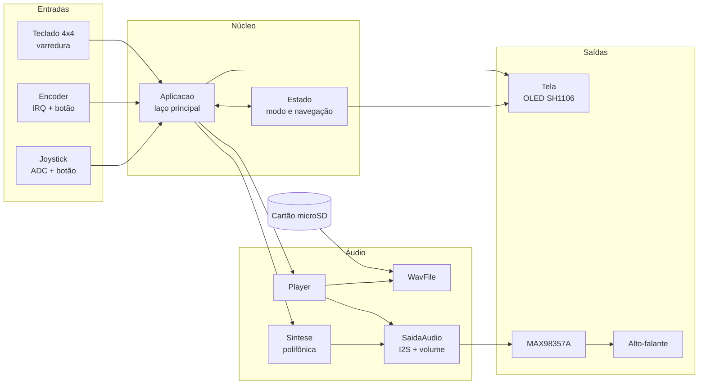
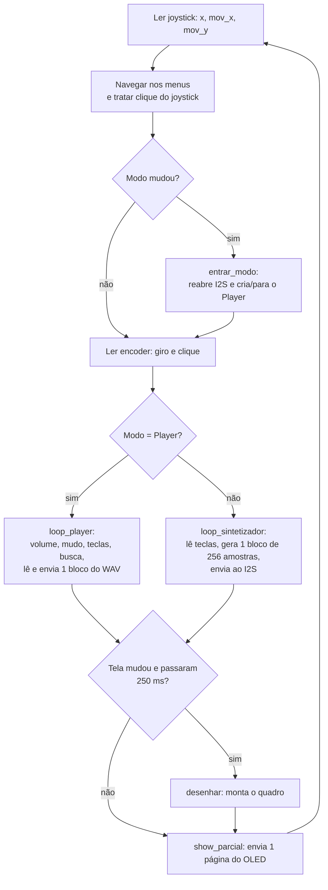
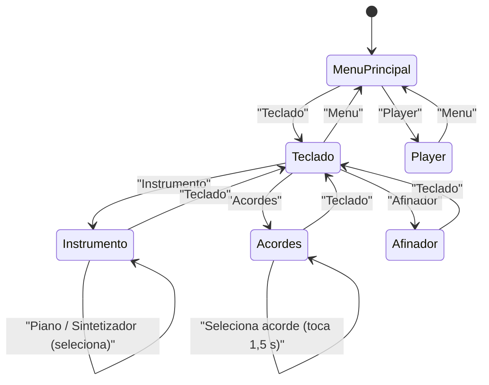

# 🎹 RaspHarmony

**Sistema embarcado sintetizador musical polifônico e reprodutor de arquivos WAV**, em MicroPython, para Raspberry Pi Pico.
Projeto da disciplina **EA801 — FEEC / Unicamp**.

<!-- IMAGEM DE CAPA: já existe uma no README atual. Troque por uma foto do projeto montado, se preferir. -->


" />

<!-- 🎥 VÍDEO/GIF DE DEMONSTRAÇÃO: grave o projeto tocando (teclado + player) e coloque aqui.
     Dica: arraste o .mp4 para o editor do GitHub e ele gera o link, ou use um GIF em docs/img/demo.gif -->


---

## Sumário

1. [Visão geral](#1-visão-geral)
2. [Equipe](#2-equipe)
3. [Estrutura do repositório](#3-estrutura-do-repositório)
4. [Versões do projeto](#4-versões-do-projeto)
5. [Hardware](#5-hardware)
6. [Arquitetura de software](#6-arquitetura-de-software)
7. [Subsistemas em detalhe](#7-subsistemas-em-detalhe)
8. [Interface e menus](#8-interface-e-menus)
9. [Desempenho, memória e tempo real](#9-desempenho-memória-e-tempo-real)
10. [Instalação e execução](#10-instalação-e-execução)
11. [Guia de uso](#11-guia-de-uso)
12. [Configuração](#12-configuração)
13. [Preparação das músicas](#13-preparação-das-músicas)
14. [Testes e validação](#14-testes-e-validação)
15. [Solução de problemas](#15-solução-de-problemas)
16. [Limitações conhecidas e próximos passos](#16-limitações-conhecidas-e-próximos-passos)
17. [Referências e links](#17-referências-e-links)
18. [Licença e créditos](#18-licença-e-créditos)

---

## 1. Visão geral

O RaspHarmony tem dois modos de operação, escolhidos num menu no display OLED:

| Modo | O que faz |
|---|---|
| **Teclado** | Sintetizador polifônico (até 4 vozes) tocado pelo teclado matricial 4×4. Instrumentos: **Piano** (modelo com duas cordas, decaimento em duas fases e "martelada"), **Sintetizador** (onda "serra" suave) e **Afinador** (senoide pura). Oitavas 3 a 5. |
| **Acordes** | 48 acordes (12 raízes × 4 tipos: maior, menor, diminuto, aumentado), tocados por 1,5 s ao selecionar. |
| **Afinador** | Ajuste fino de cada nota em **±50 cents**, com medidor visual no display. O ajuste vale para todas as oitavas e para todos os instrumentos. |
| **Player** | Reprodutor de arquivos **WAV** (PCM 16 bits, mono ou estéreo) lidos do cartão microSD, com volume, mudo, avançar/voltar faixa e busca contínua pelo joystick. |

**Principais características técnicas**

- Áudio digital por **I2S** a **44,1 kHz / 16 bits** direto para um amplificador **MAX98357A** (sem DAC analógico, sem PWM).
- Motor de síntese por **tabela de onda** com acumulador de fase de 24 bits, interpolação linear e envelopes, com os laços críticos em **`@micropython.viper`**.
- Entrada tratada por **polling cooperativo** sem `sleep` bloqueante; apenas o encoder usa interrupção (somente acumula passos).
- Display atualizado **por páginas** (`show_parcial`) para não interromper o áudio.
- Funciona **sem cartão SD**: o sintetizador continua operando e o Player avisa que não há arquivos.

---

## 2. Equipe

| Nome | RA |
|---|---|
| Paulo Sergio Gonçalves Júnior | 218474 |
| Vinicius Pedrillo de Souza | 258667 |

Disciplina **EA801** — Faculdade de Engenharia Elétrica e de Computação (FEEC), Unicamp.
Docente responsável: <!-- TODO: nome do professor(a) --> `a preencher`

---

## 3. Estrutura do repositório

```text
RaspHarmony/
├── README.md                      ← este documento
├── MicroPy_PICO-v1.29.0.uf2       ← firmware MicroPython (build para RP2040 / Pico)
├── musicas/
│   ├── Playlist.md                ← lista de músicas e comando de conversão
│   └── MP3/                       ← músicas de origem (convertê-las para WAV)
├── protoboard_version/
│   ├── protoboard.md              ← notas da versão protoboard
│   ├── modular/
│   │   ├── main/main.py           ← ponto de entrada
│   │   └── lib/                   ← módulos (copiar para /lib no Pico)
│   └── monolitico/
│       └── RaspHarmony_All.py     ← todos os módulos em um único arquivo
└── pcb_version/                   ← (a adicionar) versão em PCB
```

> Convenção sugerida para as imagens desta documentação: `docs/img/`.

---

## 4. Versões do projeto

O projeto foi feito em duas etapas, ambas em **MicroPython**:

| | **Protoboard** | **PCB** |
|---|---|---|
| Placa | Raspberry Pi **Pico 2** (RP2350) | Raspberry Pi **Pico** (RP2040) |
| Estado | Concluída | <!-- TODO --> `a preencher` |
| Pasta | `protoboard_version/` | <!-- TODO --> `pcb_version/` |
| Ligações | Esquema do [Wokwi](https://wokwi.com/projects/475915740521352193) | <!-- TODO: esquemático/Gerber --> |

### Sub-versões do software (protoboard)

| | **Modular** | **Monolítica** |
|---|---|---|
| Arquivos na placa | 14 módulos + `main.py` | 1 arquivo (`RaspHarmony_All.py`) + 2 drivers |
| Vantagem | Leitura e manutenção mais fáceis; **é a versão de referência e a mais atualizada** | Upload simples |
| Desvantagem | Vários arquivos para copiar | Consome mais memória da placa; **precisa ser regerada a cada alteração no modular** |

Ambas têm o mesmo comportamento: a monolítica é gerada a partir da modular, apenas concatenando os módulos e removendo os `import` internos.

---

## 5. Hardware

### 5.1 Lista de materiais

| Item | Descrição | Qtd. |
|---|---|---|
| Microcontrolador | Raspberry Pi Pico 2 (protoboard) / Pico (PCB) | 1 |
| Display | OLED 128×64 I2C com controlador **SH1106** (endereço `0x3C`) | 1 |
| Amplificador de áudio | Módulo I2S **MAX98357A** | 1 |
| Alto-falante | <!-- TODO: impedância e potência (ex.: 4 Ω / 3 W) --> `a preencher` | 1 |
| Armazenamento | Módulo leitor microSD (SPI) + cartão microSD | 1 |
| Teclado | Matriz 4×4 de 16 teclas | 1 |
| Joystick | Módulo analógico de 2 eixos com botão | 1 |
| Encoder | Encoder rotativo com botão (tipo KY-040) | 1 |
| Outros | Protoboard, jumpers, cabo USB | — |

<!-- 📷 IMAGEM: foto de todos os componentes lado a lado, identificados. Arquivo sugerido: docs/img/componentes.jpg -->


### 5.2 Diagrama de ligações

O esquema completo está no Wokwi: **<https://wokwi.com/projects/475915740521352193>**

<!-- Esta imagem já existe no protoboard.md; mantida aqui. -->


<!-- 📷 IMAGEM: foto da montagem real na protoboard. Arquivo sugerido: docs/img/protoboard.jpg -->


### 5.3 Pinagem (versão protoboard)

Fonte: `modular/lib/config.py`.

| Função | Sinal | GPIO | Periférico | Observação |
|---|---|---|---|---|
| **Display OLED** | SDA | GP0 | I2C0 | 400 kHz, endereço `0x3C`, rotação 180° |
| | SCL | GP1 | I2C0 | |
| **Joystick** | VRx | GP26 | ADC0 | Leitura de 16 bits |
| | VRy | GP27 | ADC1 | |
| | SW | GP28 | Digital | Pull-up interno, ativo em nível baixo |
| **Encoder** | A (CLK) | GP13 | Digital + IRQ | Pull-up interno |
| | B (DT) | GP14 | Digital + IRQ | Pull-up interno |
| | SW | GP15 | Digital | Pull-up interno |
| **Áudio I2S** | BCLK (SCK) | GP21 | I2S0 | |
| | LRC (WS) | GP22 | I2S0 | Deve ser sempre o GPIO seguinte ao BCLK |
| | DIN (SD) | GP20 | I2S0 | |
| **Cartão SD** | SCK | GP18 | SPI0 | 8 MHz |
| | MOSI | GP19 | SPI0 | |
| | MISO | GP16 | SPI0 | |
| | CS | GP17 | Digital | |
| **Teclado 4×4** | Linhas R1–R4 | GP12, GP11, GP10, GP9 | Digital | Saída só durante a varredura |
| | Colunas C1–C4 | GP8, GP7, GP6, GP5 | Digital | Pull-up interno |

> ⚠️ **Atenção:** todos os GPIOs do Pico trabalham em **3,3 V** e **não toleram 5 V**. Alimente os módulos de forma que nenhuma saída de 5 V chegue a um GPIO.

### 5.4 Mapa do teclado matricial

Colunas em pull-up; tecla apertada = nível baixo. As **3 primeiras linhas** formam o teclado musical; a **4ª linha** são os controles do Player.

|  | C1 | C2 | C3 | C4 |
|---|---|---|---|---|
| **R1** | C | C# | D | D# |
| **R2** | E | F | F# | G |
| **R3** | G# | A | A# | B |
| **R4** | Reinicia | Prev | Play/Pause | Next |

<!-- 📷 IMAGEM: foto do teclado com as notas etiquetadas. Arquivo sugerido: docs/img/teclado.jpg -->


### 5.5 Alimentação

| Item | Valor |
|---|---|
| Fonte | USB (5 V) pelo próprio Pico |
| Lógica | 3,3 V |
| Alimentação do MAX98357A | Fonte Externa 5 V |
| Consumo medido (repouso / tocando) | 5 mA / 60 mA |

### 5.6 Versão PCB

<!-- TODO: descreva as diferenças da PCB (periféricos trocados, pinagem alterada) -->

<!-- 📷 IMAGENS: esquemático (docs/img/pcb-esquematico.png), layout (docs/img/pcb-layout.png) e foto da placa pronta (docs/img/pcb-foto.jpg) -->


---

## 6. Arquitetura de software

### 6.1 Diagrama de blocos



### 6.2 Módulos (versão modular)

| Módulo | Responsabilidade |
|---|---|
| `config.py` | Pinos, constantes, tabelas de menu e parâmetros de ajuste |
| `encoder.py` | `Encoder`: decodificação em quadratura por IRQ |
| `botao.py` | `Botao`: detecção de borda com debounce sem `sleep` |
| `joystick.py` | `Joystick`: leitura analógica, calibração do centro, histerese |
| `teclado.py` | `Teclado`: varredura da matriz 4×4 |
| `armazenamento.py` | Montagem do SD e lista de `.wav` |
| `wavfile.py` | `WavFile`: leitura de cabeçalho e dados de WAV PCM |
| `audio.py` | `SaidaAudio`: I2S, volume por software e mudo |
| `midi.py` | `MIDI`: notas, frequências, acordes, escalas e afinação |
| `sintese.py` | `Sintese`: motor polifônico (tabela de onda + envelope) |
| `player.py` | `Player`: lista de faixas, play/pausa, busca, repetição |
| `estado.py` | `Estado`: estado global e navegação de menus |
| `ui.py` | `Tela`: desenho das telas no OLED |
| `app.py` | `Aplicacao`: monta o hardware e executa o laço principal |
| `sh1106.py` | Driver do OLED (de terceiros, **modificado**, ver [licenças](#18-licença-e-créditos)) |
| `sdcard.py` | Driver do cartão SD (de terceiros) |
| `sh1107.py` | Driver alternativo para display SH1107 (**não usado** pelo projeto) |

### 6.3 Laço principal

O sistema é **single-thread e cooperativo**. A escrita de cada bloco de áudio no I2S é **bloqueante** quando o buffer está cheio, e é isso que dá o ritmo ao laço.



---

## 7. Subsistemas em detalhe

### 7.1 Entradas

**Joystick** (`joystick.py`)
- Na inicialização, aguarda 100 ms e **grava a posição de repouso** como centro. **Não toque no joystick ao ligar.**
- Gera **um evento por empurrão**, com **histerese**: dispara acima de `LIMIAR` (12000, em escala de 16 bits) e só rearma quando o desvio cai abaixo de `LIMIAR/3`.
- Eixos invertidos por padrão (`INVERTE_X`, `INVERTE_Y = True`).
- Além dos eventos discretos, entrega o **desvio analógico em X**, usado pelo Player para busca proporcional.

**Encoder rotativo** (`encoder.py`)
- A interrupção (`hard=True`, nas duas bordas dos dois canais) apenas **soma passos** usando uma tabela de decodificação em quadratura (16 entradas). Nenhum acesso a SD, I2S ou OLED ocorre na IRQ.
- `cliques()` lê e zera o contador com as interrupções desabilitadas e **guarda o resto** de um clique incompleto.
- Passos por clique (detent) = 2 por padrão; ajuste para 4 em encoders KY-040 que gerem 4 passos por clique.

**Botões** (`botao.py`)
- Detecção de **borda de descida** com debounce de **250 ms por tempo** (`ticks_diff`), sem `sleep`: não prende o áudio.

**Teclado matricial** (`teclado.py`)
- Em repouso, **as linhas ficam em alta impedância (entrada)**. Só a linha varrida é levada a 0 V, por 20 µs, antes da leitura das colunas (pull-up).
- Isso evita que uma tecla fechada em outra linha puxe colunas para baixo e que duas teclas na mesma coluna coloquem duas saídas em curto (uma em 0 e outra em 1).
- Limitação: não há diodos por tecla, então certas combinações de 3 ou mais teclas podem gerar teclas "fantasma".

### 7.2 Display e interface (`ui.py`, `sh1106.py`)

- OLED **128×64**, fonte 8×8 do `framebuf` → **16 colunas × 8 linhas** de texto. A fonte é só ASCII (sem acentos).
- Grade vertical padronizada: título em y=0, divisória em y=9, linhas de conteúdo a partir de y=11 (passo 9), notas tocando em y=47 e rodapé em y=56.
- **Redesenho condicionado**: `chave_visual()` resume o que está na tela (modo, seleção, notas, volume, posição da faixa, etc.). O quadro só é remontado quando essa chave muda **e** já passaram 250 ms desde o último.
- **Envio parcial** (`show_parcial(1)`): o driver foi modificado para enviar **1 das 8 páginas por iteração do laço**. Cada página são ~130 bytes em I2C a 400 kHz (≈ 3 ms, estimativa), em vez de ~25 ms do quadro inteiro, evitando que o áudio engasgue.
- Letreiro rolante para nomes de faixa com mais de 16 caracteres.

<!-- 📷 IMAGENS: uma foto/captura de cada tela do OLED. Sugestão de arquivos abaixo. -->

| Menu principal | Teclado | Instrumento |
|:-:|:-:|:-:|
|  |  |  |

| Acordes | Afinador | Player |
|:-:|:-:|:-:|
|  |  |  |

### 7.3 Áudio (`audio.py`)

- **I2S0 TX**, 16 bits, **mono**, 44,1 kHz (estéreo se o WAV for estéreo). O I2S só é recriado quando taxa, canais ou tamanho de buffer mudam.
- O MAX98357A **não tem controle de volume por I2S**, então o volume é feito **em software**:
  - Percentual (0–100 %) convertido em ganho de ponto fixo, com **curva quadrática** (`ganho = vol² · 4096 / 10000`), que soa mais natural que a linear.
  - No Player, `aplicar_volume` (viper) multiplica o bloco PCM em memória.
  - No sintetizador, o ganho entra na etapa final de `finalizar`.
- Passo de volume: **2 %** por clique; volume inicial: **30 %**. Mudo pelo botão do encoder (no Player).
- Com o Player pausado, o sistema envia **blocos de silêncio** para manter o I2S alimentado e evitar ruídos.

### 7.4 Síntese (`midi.py`, `sintese.py`)

**Notas e afinação**

- Número MIDI → frequência: `f = 440 · 2^((n − 69)/12)` (temperamento igual, A4 = 440 Hz).
- Com o Afinador: `f = 440 · 2^((n − 69)/12 + cents/1200)`, com um ajuste de **−50 a +50 cents** por nota (uma das 12), válido para todas as oitavas.
- Acordes: tríades a partir de C4 (MIDI 60) com intervalos `[0,4,7]` maior, `[0,3,7]` menor, `[0,3,6]` diminuto e `[0,4,8]` aumentado.

**Motor de síntese**

| Parâmetro | Valor |
|---|---|
| Bloco de geração | 512 amostras (≈ 11,6 ms) |
| Tabelas de onda | 1024 amostras (int16) |
| Acumulador de fase | 24 bits (resolução de frequência ≈ 0,0026 Hz) |
| Leitura da tabela | Interpolação linear (fração de 8 bits) |
| Amplitude | Ponto fixo Q12 com **rampa linear** dentro do bloco |
| Polifonia máxima | **4 vozes** (`MAX_VOZES`) |
| Limitador | "Joelho suave": acima de 16384 a inclinação cai para 1/8, antes de saturar em 16 bits |

As rotinas pesadas (`mix_voz`, `mix_dupla`, `finalizar`, `aplicar_volume`) são compiladas com `@micropython.viper`.

**Instrumentos**

| Instrumento | Característica |
|---|---|
| **Piano** | tabela "rica" escolhida por registro (grave: muitos harmônicos; médio; agudo: poucos, evita som estridente) somada a uma tabela "escura"; decaimento em **duas fases** (rápida τ≈0,22 s + lenta de 3,2 s no grave a 0,9 s no agudo); **brilho que decai** (a nota migra da tabela rica para a "escura"); **duas cordas** levemente desafinadas (~2,5 cents), com a 2ª corda a 35 % para o batimento virar ondulação; **martelada** por ruído de ~17 ms. Tabelas normalizadas por **RMS** para terem o mesmo volume percebido. |
| **Sintetizador** | Onda "serra" suave (10 harmônicos, amplitude 1/h), ataque suave e sustentação plena. |
| **Afinador** | Senoide pura. |

> As constantes de envelope são definidas "por bloco de 256" e **escaladas** pelo tamanho real do bloco. Assim os tempos em segundos não mudam se o bloco for alterado.

### 7.5 Player e arquivos WAV (`player.py`, `wavfile.py`, `armazenamento.py`)

- O SD é montado em `/sd` via **SPI0 a 8 MHz**. A lista de faixas contém os `.wav` da **raiz** do cartão, em **ordem alfabética**. Subpastas não são lidas.
- `WavFile` interpreta o cabeçalho RIFF, ignora chunks extras (`LIST`, `INFO`) e aceita **somente PCM (formato 1)**. O Player recusa arquivos que não sejam **16 bits, mono ou estéreo**.
- Leitura em blocos de **8192 bytes** (≈ 93 ms de áudio mono) direto para um buffer pré-alocado (`readinto`), sem alocar memória a cada bloco.
- Ao entrar no modo Player, a **faixa 1 começa a tocar automaticamente**.
- Fim de faixa → **próxima**; a última volta para a primeira (`REPETIR_LISTA = True`).
- **Busca pelo joystick**: o desvio em X avança/retrocede proporcionalmente, até **15 s de áudio por segundo real** no fundo de escala.
- Ao sair do Player, a reprodução para e o mudo é desfeito.

---

## 8. Interface e menus



- **Mover:** joystick para cima/baixo. Na lista de acordes, **esquerda/direita pula de raiz em raiz** (4 itens).
- **Selecionar:** botão do joystick.
- No modo Teclado, é possível tocar mesmo com o cursor no menu: as teclas musicais sempre soam.

---

## 9. Desempenho, memória e tempo real

### 9.1 Latências e buffers

| Item | Valor | Cálculo |
|---|---|---|
| Buffer I2S (sintetizador) | 4096 bytes | 2048 amostras ÷ 44100 ≈ **46,4 ms** |
| Bloco de síntese | 256 amostras | ≈ **5,8 ms** |
| Buffer I2S (Player) | 32768 bytes | 16384 amostras ÷ 44100 ≈ **372 ms** de folga |
| Bloco de leitura do SD | 8192 bytes | ≈ **93 ms** de áudio mono |
| Taxa de dados do WAV (mono, 16 bits) | 88,2 kB/s | ≈ 5,3 MB por minuto |

O buffer maior do Player dá folga para o SD e para o display sem "falhas" no áudio. O menor no sintetizador reduz a latência entre apertar a tecla e ouvir o som.

### 9.2 Estimativa de uso de RAM

| Item | ≈ RAM |
|---|---|
| Tabelas de onda (6 com sinal + 4 sem sinal + 1 de ruído, 2 KB cada) | 22 KB |
| Buffer I2S do Player | 32 KB |
| Buffer de leitura do SD | 8 KB |
| Buffer do display (128×64 monocromático) | 1 KB |
| Acumulador e saída da síntese | 1,5 KB |
| Total | 64,5 KB = 12% do Pico 2 |

São **estimativas**; para medir na sua placa:

```python
import gc
gc.collect()
print("livre:", gc.mem_free(), "usada:", gc.mem_alloc())
```

A versão **monolítica** compila um único arquivo grande de uma vez e tende a usar mais heap durante o boot que a modular.

### 9.3 Resultados medidos

<!-- TODO: preencha com medidas reais -->

| Métrica | Resultado |
|---|---|
| RAM livre após o boot (modular) | `a preencher` |
| RAM livre após o boot (monolítica) | `a preencher` |
| Latência tecla → som | `a preencher` |
| Falhas de áudio (underruns) observadas | `a preencher` |
| Consumo de corrente | `a preencher` |

<!-- 📷 IMAGEM (opcional): captura de osciloscópio/analisador lógico do sinal I2S ou da forma de onda de uma nota. docs/img/osciloscopio.png -->


---

## 10. Instalação e execução

### 10.1 Gravar o firmware MicroPython

1. Segure o botão **BOOTSEL** e conecte o USB. Um drive (`RPI-RP2` ou `RP2350`) aparece.
2. Copie o `.uf2` para o drive. A placa reinicia sozinha.

> ⚠️ O arquivo `MicroPy_PICO-v1.29.0.uf2` deste repositório é o build para **Raspberry Pi Pico (RP2040)**. Para a **Pico 2 (RP2350)**, baixe o firmware específico em <https://micropython.org/download/RPI_PICO2/>.

### 10.2 Copiar os arquivos para a placa

Use o [Thonny](https://thonny.org/) ou o [`mpremote`](https://docs.micropython.org/en/latest/reference/mpremote.html).

**Opção A: modular (recomendada)**

```bash
mpremote fs mkdir :lib
mpremote fs cp protoboard_version/modular/lib/*.py :lib/
mpremote fs cp protoboard_version/modular/main/main.py :main.py
```

O MicroPython já inclui `/lib` no caminho de importação. O `sh1107.py` não é necessário.

**Opção B: monolítica**

```bash
mpremote fs mkdir :lib
mpremote fs cp protoboard_version/modular/lib/sh1106.py :lib/
mpremote fs cp protoboard_version/modular/lib/sdcard.py :lib/
mpremote fs cp protoboard_version/monolitico/RaspHarmony_All.py :main.py
```

> Use o `sh1106.py` **deste repositório**: o projeto chama `show_parcial()`, que não existe no driver original.

### 10.3 Preparar o cartão SD

1. Formate o cartão em **FAT32**.
2. Converta as músicas para WAV ([seção 13](#13-preparação-das-músicas)).
3. Copie os `.wav` para a **raiz** do cartão.

### 10.4 Executar

Reinicie a placa (ou clique em *Run* no Thonny). O `main.py` roda automaticamente ao ligar.

---

## 11. Guia de uso

### 11.1 Controles

| Controle | Menus | Teclado / Instrumento | Acordes | Afinador | Player |
|---|---|---|---|---|---|
| **Joystick ↑/↓** | Mover cursor | Mover cursor | Mover cursor | — | — |
| **Joystick ←/→** | — | — | Pula de raiz em raiz | Troca a nota | **Busca** na faixa (proporcional) |
| **Botão do joystick** | Selecionar | Selecionar | Tocar acorde / selecionar | Selecionar | Selecionar "Menu" |
| **Encoder (giro)** | **Volume** | **Volume** | **Volume** | **Afina** a nota (±1 cent) | **Volume** |
| **Encoder (clique)** | — | Troca a **oitava** (3→4→5→3) | — | **Zera** a afinação da nota | **Mudo** |
| **Teclas R1–R3** | — | **Tocam as notas** | — | Escolhem a nota | — |
| **Teclas R4** | — | — | — | — | Reinicia / Prev / Play-Pause / Next |

### 11.2 Receitas rápidas

- **Tocar piano:** Menu → *Teclado* → use as teclas R1–R3. Clique no encoder para mudar a oitava.
- **Trocar o instrumento:** *Teclado* → *Instrumento* → *Piano* ou *Sintetizador* (aparece um `*` no escolhido) → *Teclado*.
- **Tocar um acorde:** *Teclado* → *Acordes* → escolha → clique no joystick.
- **Afinar uma nota:** *Teclado* → *Afinador* → tecla da nota → gire o encoder até o ponteiro ficar no centro.
- **Ouvir música:** Menu → *Player* (a 1ª faixa começa sozinha).

---

## 12. Configuração

Todos os ajustes ficam em `modular/lib/config.py` (na monolítica, estão no início do arquivo).

| Parâmetro | Padrão | Efeito |
|---|---|---|
| `INVERTE_X`, `INVERTE_Y` | `True` | Inverte o sentido do joystick |
| `LIMIAR` | `12000` | Sensibilidade do joystick (0–32768) |
| `SAMPLE_RATE` | `44100` | Taxa de amostragem do sistema |
| `IBUF_SINT` | `4096` | Buffer I2S do sintetizador (menor = menos latência, mas mais risco de falha) |
| `IBUF_PLAYER` | `32768` | Buffer I2S do Player (maior = mais folga, custa RAM) |
| `TAM_BUFFER` | `8192` | Bytes lidos do SD por vez (múltiplo de 512) |
| `REPETIR_LISTA` | `True` | Volta à 1ª faixa ao fim da lista |
| `VOLUME_INICIAL` | `30` | Volume ao ligar (%) |
| `VOL_PASSO` | `2` | % de volume por clique do encoder |
| `DURACAO_ACORDE_MS` | `1500` | Duração do acorde |
| `PASSO_CENTS`, `LIM_CENTS` | `1`, `50` | Passo e limite do Afinador |

---

## 13. Preparação das músicas

O Player aceita **WAV PCM, 16 bits, 44,1 kHz** (mono ou estéreo). Converta com o [FFmpeg](https://ffmpeg.org/):

```bash
# um arquivo
ffmpeg -i "nome.mp3" -ar 44100 -ac 1 -c:a pcm_s16le "nome.wav"

# todos os MP3 da pasta (Linux/macOS)
for f in *.mp3; do ffmpeg -i "$f" -ar 44100 -ac 1 -c:a pcm_s16le "${f%.mp3}.wav"; done
```

```powershell
# todos os MP3 da pasta (Windows PowerShell)
Get-ChildItem *.mp3 | ForEach-Object { ffmpeg -i $_.FullName -ar 44100 -ac 1 -c:a pcm_s16le ($_.BaseName + ".wav") }
```

**Dicas**
- Use nomes **sem acentos e sem caracteres especiais**: a fonte do display só tem ASCII.
- Mono 44,1 kHz ocupa ≈ 5,3 MB por minuto.
- Arquivos em subpastas do SD **não** aparecem na lista.

### Lista de músicas do projeto

Life Goes On · Thunderstruck · Bohemian Rhapsody · Até que Durou · Sinônimos · Silhouette · Céu Azul · The Real Slim Shady · Castlevania (Matuê)

---

## 14. Testes e validação

Roteiro de bring-up para validar cada subsistema isoladamente (REPL do MicroPython):

| # | Teste | Como | Resultado esperado |
|---|---|---|---|
| 1 | Display no barramento | `from machine import I2C, Pin; print(I2C(0, scl=Pin(1), sda=Pin(0)).scan())` | `[60]` (0x3C) |
| 2 | Cartão SD | `import armazenamento as a; print(a.montar_sd(18, 19, 16, 17, "/sd"))` | Lista de `.wav` |
| 3 | Joystick | Imprimir `Joystick(26, 27, 28).ler()` movendo os eixos | Valores variam; centro ≈ 0 |
| 4 | Encoder | Girar e imprimir `Encoder(...).cliques()` | +1 / −1 por clique |
| 5 | Teclado | Imprimir `Teclado(...).scan(True)` apertando teclas | Nome das notas |
| 6 | Áudio | Abrir o app e tocar uma tecla | Nota limpa, sem estalos |
| 7 | Player | Entrar no Player com 1 WAV | Toca e a barra de progresso avança |
| 8 | Estabilidade | Tocar acordes de 4 notas com volume alto, 5 min | Sem reinício, sem distorção forte |

<!-- TODO: registre os resultados reais (ok/falhou, data, observações) -->

---

## 15. Solução de problemas

| Sintoma | Causa provável | O que fazer |
|---|---|---|
| `ImportError: no module named 'sh1106'` / `'sdcard'` | Drivers não estão em `/lib` | Copie `sh1106.py` e `sdcard.py` para `/lib` |
| `AttributeError: ... show_parcial` | `sh1106.py` antigo/original na placa | Use o `sh1106.py` deste repositório |
| Display apagado | Endereço, fiação SDA/SCL ou alimentação | Rode o teste 1; confira GP0/GP1 e o endereço |
| Display de cabeça para baixo | Rotação | Altere `rotate=180` em `app.py` |
| "Sem arquivos / WAV no SD" | SD ausente, sem FAT32 ou sem `.wav` na raiz | Teste 2; revise a formatação e a pasta |
| Faixa não toca | WAV não é PCM 16 bits | Reconverta com o comando da seção 13 |
| Sem som | Fiação I2S, amplificador sem alimentação, volume 0/mudo | Confira GP20/21/22 e se `LRC` = `BCLK+1` |
| Estalos ou falhas no áudio | Buffer pequeno, SD lento ou display ocupando o laço | Aumente `IBUF_PLAYER`/`IBUF_SINT`; use cartão de qualidade |
| Joystick "anda sozinho" | Centro calibrado com o joystick tocado | Reinicie sem encostar no joystick |
| Joystick navega ao contrário | Montagem do módulo | Inverta `INVERTE_X` / `INVERTE_Y` |
| Encoder pula ou conta dobrado | Passos por clique incompatíveis | Mude `passos_por_clique` (2 ↔ 4) |
| Teclas fantasmas | Várias teclas sem diodo | Limitação da matriz (ver 7.1) |
| `MemoryError` ao iniciar | Pouca RAM livre | Prefira a versão modular; reduza `IBUF_PLAYER` |

---

## 16. Limitações conhecidas e próximos passos

**Limitações**
- Polifonia limitada a **4 vozes**.
- Só WAV **PCM 16 bits**; sem MP3/FLAC.
- Sem leitura de subpastas e sem seleção de faixa por nome (apenas anterior/próxima).
- Sem diodos na matriz de teclas (possíveis teclas fantasma).
- Fonte do display sem acentos.
- Sem persistência da afinação, do volume e do instrumento ao desligar.
- A versão monolítica precisa ser regerada manualmente quando o código modular muda.

**Ideias futuras**
- [ ] Salvar configurações (afinação, volume, instrumento) na flash
- [ ] Mais instrumentos e escalas (a classe `MIDI` já tem os intervalos de escala)
- [ ] Menu de seleção de faixas
- [ ] Entrada MIDI/USB
- [ ] Script para gerar a versão monolítica automaticamente

---

## 17. Referências e links

**Projeto**
- Esquema de ligações (Wokwi): <https://wokwi.com/projects/475915740521352193>
- Repositório: <https://github.com/palo-lord/RaspHarmony>

**Software**
- MicroPython: <https://micropython.org/>
- Downloads de firmware: [Pico (RP2040)](https://micropython.org/download/RPI_PICO/) · [Pico 2 (RP2350)](https://micropython.org/download/RPI_PICO2/)
- Referência rápida RP2: <https://docs.micropython.org/en/latest/rp2/quickref.html>
- `machine.I2S`: <https://docs.micropython.org/en/latest/library/machine.I2S.html>
- Código viper (otimização): <https://docs.micropython.org/en/latest/reference/speed_python.html>
- `mpremote`: <https://docs.micropython.org/en/latest/reference/mpremote.html>
- Thonny: <https://thonny.org/>
- FFmpeg: <https://ffmpeg.org/>

**Hardware (datasheets)**
- Raspberry Pi Pico: <https://datasheets.raspberrypi.com/pico/pico-datasheet.pdf>
- Raspberry Pi Pico 2: <https://datasheets.raspberrypi.com/pico2/pico-2-datasheet.pdf>
- MAX98357A (Analog Devices): <https://www.analog.com/en/products/max98357a.html>
- Controlador SH1106: <!-- TODO: link do datasheet do seu módulo -->

**Drivers de terceiros**
- SH1106: <https://github.com/robert-hh/SH1106>
- SD card: <https://github.com/micropython/micropython-lib/tree/master/micropython/drivers/storage/sdcard>

**Teoria**
- Número MIDI e frequência: <https://en.wikipedia.org/wiki/MIDI_tuning_standard>
- I2S: <https://en.wikipedia.org/wiki/I%C2%B2S>
- Síntese por tabela de onda: <https://en.wikipedia.org/wiki/Wavetable_synthesis>

---

## 18. Licença e créditos

**Licença do projeto:** <!-- TODO: escolha uma (ex.: MIT) e adicione um arquivo LICENSE na raiz --> `a definir`

**Componentes de terceiros**

| Componente | Origem | Licença |
|---|---|---|
| `sh1106.py` | Radomir Dopieralski, Robert Hammelrath e Tim Weber. **Modificado** neste projeto (adição de `show_parcial`) | MIT |
| `sdcard.py` | MicroPython (micropython-lib) | MIT |
| Firmware MicroPython | Projeto MicroPython | MIT |

**Músicas:** os arquivos em `musicas/MP3/` são obras com direitos autorais de terceiros, usadas aqui para fins acadêmicos. Antes de tornar o repositório público ou distribuí-lo, confira se é permitido manter esses arquivos nele; uma alternativa é publicar apenas a lista (`Playlist.md`) e usar áudios livres de direitos nos exemplos.

**Agradecimentos:** docentes e monitores da disciplina EA801 (FEEC/Unicamp) e à comunidade MicroPython.
